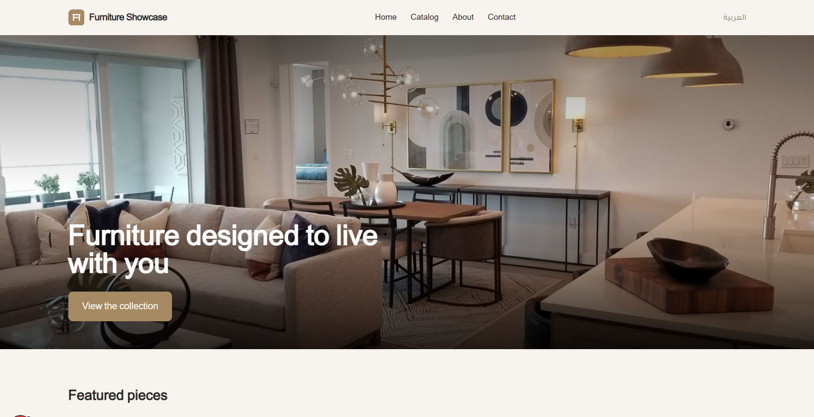
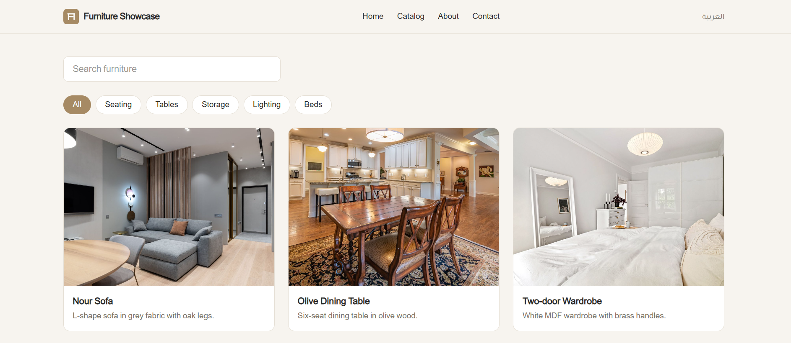
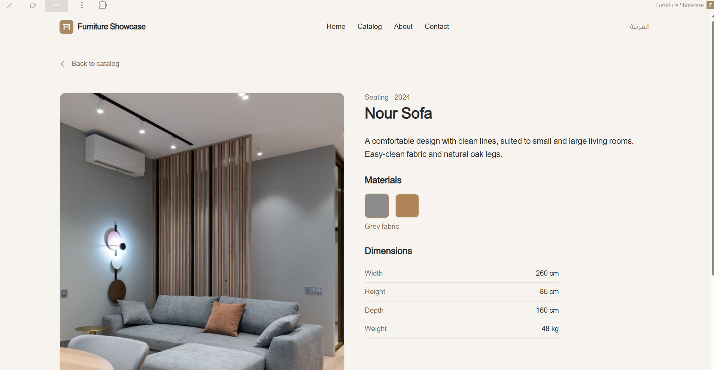

# Furniture Showcase

A bilingual (Arabic / English) furniture showcase built as a Progressive Web App.
It is a portfolio project: it presents pieces and invites contact. It has no cart and no payments.

## Screenshots

Add screenshots to `docs/screenshots/` and link them here, for example:

| Home | Catalog | Product |
|---|---|---|
|  |  |  |

## Features

- Arabic (RTL) and English (LTR) with a language switch that keeps the current page
- Catalog with search and category filter
- Product pages: image gallery, material swatches, dimensions table, WhatsApp contact
- About and contact pages, with email, WhatsApp, Instagram, and Facebook links
- Installable PWA with an offline catalog (service worker precache)
- Install prompt for Android and desktop, and iOS install steps

## Tech stack

- Next.js 16 (App Router, Turbopack, Cache Components)
- React 19, TypeScript
- Tailwind CSS 4
- Serwist (service worker, via `@serwist/turbopack`)
- Vitest and Testing Library for tests
- Self-hosted fonts: Tajawal (Arabic) and Inter (Latin)

## Getting started

Requirements: Node.js 20.9 or newer.

```bash
npm install
cp .env.example .env.local   # then set NEXT_PUBLIC_WHATSAPP_NUMBER
npm run dev
```

Open http://localhost:3000. The site redirects to `/ar`.

## Scripts

| Command | What it does |
|---|---|
| `npm run dev` | Start the development server |
| `npm run build` | Production build (also generates the service worker) |
| `npm run start` | Serve the production build |
| `npm test` | Run unit tests |
| `npm run lint` | Run ESLint |
| `npm run images:fetch` | Download Pexels photos (needs `PEXELS_API_KEY`, optional) |

## Configuration

| Where | What |
|---|---|
| `NEXT_PUBLIC_WHATSAPP_NUMBER` (env) | WhatsApp number in international format, digits only. The button is hidden if empty. |
| `src/data/contact.json` | Email, Instagram, and Facebook links. Empty values are hidden. |
| `src/lib/site.ts` | Site name and footer year |
| `src/data/products.json` | Products (bilingual names, descriptions, dimensions, materials, images) |
| `src/data/about.json` | About page text (bilingual) |
| `src/i18n/ar.json`, `src/i18n/en.json` | UI strings. Both files must have the same keys. |

## Adding a product

1. Add an entry to `src/data/products.json` with `ar` and `en` text for every text field.
2. Put 1 to 5 images in `public/images/products/` and reference them by path.
3. Run `npm test` and `npm run build`. The build fails if a text field is missing a language.

## Project structure

```
src/
  app/
    [locale]/        pages for /ar and /en (home, catalog, product, about, contact, offline)
    serwist/         service worker route
    sw.ts            service worker source
  components/        layout, home, catalog, product, pwa
  data/              products, about, contact, image credits
  hooks/             install prompt logic
  i18n/              UI strings (ar, en)
  lib/               product loader, filters, WhatsApp link, i18n helpers
  types/             shared TypeScript types
public/
  images/            hero and product photos
  icons/             PWA icons
  manifest.json      web app manifest
```

## Images

Product and hero photos are from [Pexels](https://www.pexels.com) under the Pexels License (free for commercial use). Each photo's link is listed in `src/data/image-credits.json`.

## Deployment

The project deploys to Vercel without extra configuration:

1. Import the repository in Vercel.
2. Add `NEXT_PUBLIC_WHATSAPP_NUMBER` in Project Settings, then Environment Variables.
3. Deploy. Each push to the main branch deploys automatically.

## License

All rights reserved. Contact the author before reusing the code or content.
